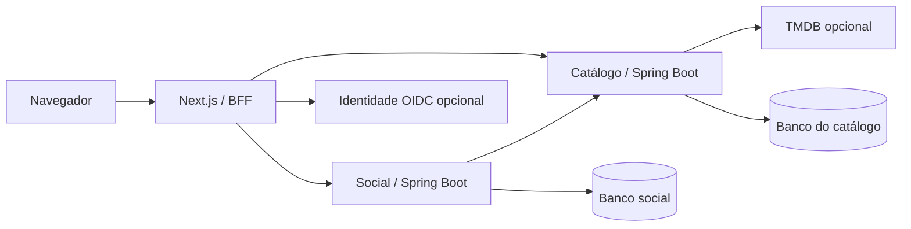

# Cena Aberta

Diário audiovisual em português para descobrir, registrar e avaliar filmes, séries e animes. Anime é uma categoria compartilhada por filmes e séries. Projeto em versão alpha, com frontend Next.js e serviços Java independentes.

A demonstração inclui busca, filtros, perfil, “Quero assistir”, notas de meia a cinco estrelas, resenhas com spoilers, diário com revisualizações e listas ordenadas. O catálogo fictício funciona sem credenciais externas.

Cada obra tem uma página própria. No perfil, “Vou ver” e “Assistidos e avaliações” exibem cards. O ranking pessoal separa filmes, séries e animes e permite organizar até 100 obras assistidas entre cinco categorias: Obra-prima, Muito bom, Bom, Regular e Não gostei. As posições são salvas automaticamente. No celular, seletores e setas permitem mover e reordenar os cards; em caso de falha, **Salvar ranking** repete a tentativa sem descartar a organização local.

Séries e animes seriados recebem notas por episódio: a média da temporada considera apenas episódios avaliados, e a média da obra considera as temporadas com notas. Avaliações públicas são opcionais e aparecem na comunidade da obra com avatar, nota e indicação de spoiler.

A primeira resenha registra a primeira sessão no diário e leva ao seu perfil. Para registrar uma revisualização, marque **Vi novamente**, clique em **Registrar sessão** e confirme. A revisualização guarda a data e a hora do clique.

## Executar localmente

Requisitos: Java 21, Maven e Node.js 24. Na raiz deste projeto:

```shell
mvn -B package
npm --prefix apps/web ci
npm --prefix apps/web run build
node scripts/local.mjs
```

Abra [http://localhost:3000](http://localhost:3000) e clique em **Criar conta** ou **Entrar**. A página inicial apresenta o projeto. O catálogo e as funções pessoais exigem uma conta. Os dados locais e a chave de sessão gerada pelo inicializador ficam em `data/`. Você pode configurar outra chave com `NEXTAUTH_SECRET` no ambiente ou no `.env`. Os três processos escutam apenas no computador local. Encerre com Ctrl+C.

No login por e-mail, **Manter conectado** guarda a sessão no navegador por até 30 dias. Com a opção desmarcada, a sessão expira em até oito horas e o navegador recebe um cookie de sessão.

### Docker Compose e PostgreSQL

Copie `.env.example` para `.env` e preencha os segredos e as senhas com valores distintos. Os segredos internos exigem pelo menos 24 caracteres. Execute `docker compose up --build` e abra a mesma URL. O Compose configura dois bancos PostgreSQL persistentes. Somente a interface web é publicada no host.

### Cadastro e recuperação por e-mail

Em **Criar conta**, informe o e-mail. Abra o link recebido, defina a senha e complete o perfil com nome, nome de usuário e CPF. A foto é opcional e aparece no perfil. O CPF é validado no servidor e mantido privado. O mesmo padrão de link vale para **Esqueci a senha**. Os links expiram em uma hora e só podem ser usados uma vez.

O inicializador local habilita o cadastro com `EMAIL_MODE=log` por padrão. Nesse modo, use um endereço fictício e abra o link exibido no terminal do serviço social. Para enviar via Brevo, configure `EMAIL_ACCOUNTS=true`, `EMAIL_MODE=smtp`, `SMTP_HOST=smtp-relay.brevo.com`, `SMTP_PORT=587`, `SMTP_USERNAME`, `SMTP_PASSWORD`, `SMTP_STARTTLS=true` e `MAIL_FROM` com um remetente verificado no `.env` deste projeto. Defina `FRONTEND_URL` com o endereço que o destinatário consegue abrir. Em ambiente hospedado, use HTTPS. [SMTP da Brevo](https://help.brevo.com/hc/en-us/articles/7924908994450-Send-transactional-emails-using-Brevo-SMTP)

As senhas são armazenadas como hash BCrypt. A recuperação invalida sessões anteriores. A escolha de OIDC substitui o cadastro por e-mail neste ambiente. O modo SMTP ainda precisa de validação com as credenciais e o remetente do Cena Aberta.

### Ativar filmes e séries reais com TMDB

1. Na seção API das configurações da sua conta TMDB, solicite acesso e copie o **API Read Access Token**.
2. Na raiz do projeto, copie `.env.example` para `.env` caso ele ainda não exista. Preencha a linha `TMDB_TOKEN=` com o token. O arquivo local é ignorado pelo Git.
3. Reinicie `node scripts/local.mjs` ou execute `docker compose up -d catalog` se já estiver usando Compose. Entre com sua conta e busque um título, como *Cidade de Deus*.

O catálogo consulta a API em PT-BR e carrega detalhes sob demanda. O filtro de anime usa animação em japonês como heurística. Com o token vazio, o catálogo exibe obras fictícias. A tela de créditos exibe a atribuição ao TMDB. [Autenticação da API](https://developer.themoviedb.org/docs/authentication-application) · [Atribuição e condições de uso](https://developer.themoviedb.org/docs/faq)

## Arquitetura



O BFF verifica a sessão e autoriza os caminhos de API expostos ao navegador. Os serviços recebem a identidade derivada da sessão pelo canal interno autenticado. Cada serviço tem credencial e migrações próprias. O catálogo usa identificadores estáveis com o tipo de mídia do provedor. O social é responsável pela propriedade dos registros e aplica as mudanças de biblioteca e avaliações em transações locais. Criações de listas e sessões aceitam `Idempotency-Key` e reusam o resultado para a mesma requisição por 24 horas.

## Verificação

Com os builds prontos, execute `node scripts/smoke.mjs`. O teste sobe servidores temporários em loopback e, por padrão, bancos H2 em memória. Ele verifica autenticação interna, busca, categorias, regras de nota e interesse, conflito de edição, idempotência, propriedade de registros, ordem de listas, sessão web e proteção de origem. O workflow do GitHub executa os mesmos builds e testes.

O mesmo teste passou com PostgreSQL 16 em bancos descartáveis. Para repetir, forneça dois bancos vazios com `SMOKE_CATALOG_JDBC` e `SMOKE_SOCIAL_JDBC`, além de `SMOKE_DB_USER` e `SMOKE_DB_PASSWORD`. O teste cria registros, então use apenas bancos de teste.

## Limites desta entrega

O ambiente verificado é a demonstração local. O código prevê Keycloak por OIDC com e-mail verificado e lista de sujeitos convidados. Para configurá-lo, preencha `OIDC_ISSUER`, `OIDC_CLIENT_ID`, `OIDC_CLIENT_SECRET` e `INVITED_SUBJECTS`, e registre a URL de retorno `/api/auth/callback/keycloak` no cliente OIDC. A remoção da lista deve ser aplicada ao ambiente web para invalidar o acesso na próxima verificação de sessão. [Documentação OIDC do Keycloak](https://www.keycloak.org/securing-apps/oidc-layers)

A liberação para usuários reais ainda requer validar a opção de identidade escolhida com credenciais reais (SMTP ou OIDC), validar o TMDB, ensaiar restauração, concluir moderação e privacidade operacionais e testar hospedagem HTTPS. O cadastro por e-mail aceita qualquer endereço verificado quando habilitado. Use OIDC com a lista de convidados para um alpha restrito por convite. O diário e “Quero assistir” são privados. Notas e resenhas só entram na comunidade quando o autor ativa a avaliação pública. Listas públicas são visíveis aos participantes com acesso. Nesta primeira entrega, o painel tem limites de consulta em vez de paginação completa nas áreas sociais.

O catálogo de demonstração e a identidade visual são próprios. O projeto se inspira na ideia de diário audiovisual do Letterboxd.


## Desenvolvimento mobile e próximas entregas

O [plano mobile](PLANO_MOBILE.md) registra as etapas, verificações e limitações. A rodada em aparelho real cobriu Chrome no Galaxy S24, teclado virtual, seleção de avatar e reordenação do ranking. iPhone e PWA permanecem fora da validação atual.

As próximas entregas são cadastro por convite com e-mail verificado, implantação em VM Linux ARM com Docker Compose, acesso HTTPS pelo Tailscale Funnel e backup externo com ensaio de restauração. Esses itens ainda não estão implementados ou validados neste repositório.

## Configuração privada

O repositório contém apenas o modelo `.env.example`, sem credenciais. Crie seu `.env` localmente e mantenha tokens do TMDB, credenciais SMTP, segredos de sessão e senhas de bancos fora do controle de versão. Bancos, uploads de usuários, certificados, logs e capturas locais não fazem parte da distribuição. O teste de integração utiliza contas fictícias e serviços simulados; não precisa de credenciais do TMDB ou SMTP.
